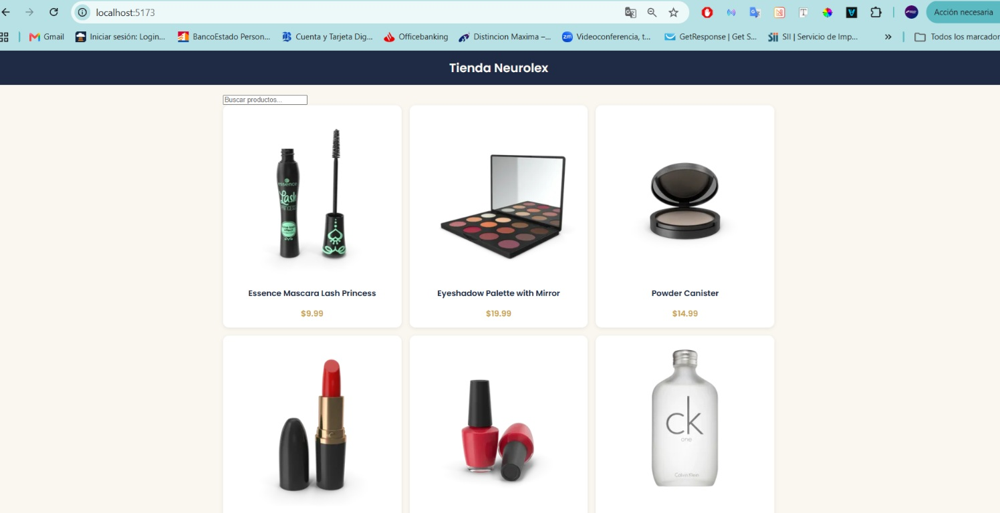
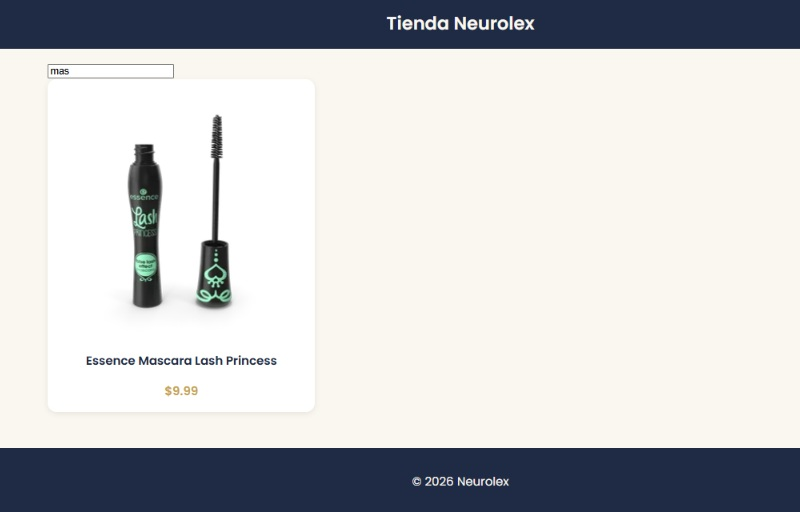

# Tienda Neurolex

> Proyecto del Módulo 2: E-commerce en React · Diplomado Fullstack IPSS

## Descripción

Tienda online construida con React que consume la API pública de DummyJSON. Muestra un listado de productos obtenidos dinámicamente, permite buscarlos por nombre y maneja los estados de carga y error con mensajes propios. El diseño es responsivo (mobile first) y usa una paleta de colores y tipografía propias.

## Capturas

**Vista general**



**Búsqueda funcionando**



## Componentes

- `Header`: logo y nombre de la tienda
- `SearchBar`: input controlado para buscar por nombre
- `ProductCard`: muestra un producto recibido por props
- `ProductList`: renderiza la lista de productos con `.map()`
- `Loader`: indicador de carga
- `ErrorMessage`: muestra el error cuando falla la API
- `Footer`: información básica

## Cómo ejecutar el proyecto

```bash
git clone https://github.com/cristobaldiazonline/ecommerce-react.git
cd ecommerce-react
npm install
npm run dev
```

Luego abre la dirección que muestre la terminal (normalmente `http://localhost:5173`).

## Tecnologías

- React
- Vite
- JavaScript (fetch + useEffect + useState)
- CSS propio con variables y media queries
- API: [DummyJSON](https://dummyjson.com/products)